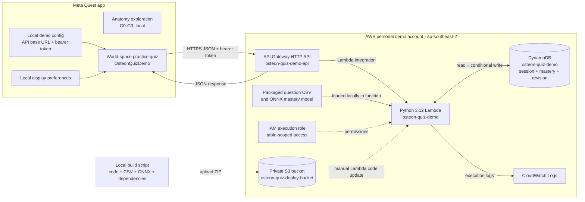

# AWS architecture — practice quiz demo

> Documented demo architecture as of 2026-10-14. The AWS resources are in a
> maintainer's personal account in `ap-southeast-2`. This diagram reflects the
> repository documentation; it has not been checked against the AWS console.

The live quiz calls are `POST /v1/sessions`, `GET /v1/sessions/current`, and
`POST /v1/sessions/{session_id}/answers`. Lambda validates the temporary bearer
token and maps it to one fixed demo learner. It selects questions and scores
answers using the packaged CSV and ONNX model, then stores progress in DynamoDB.
The Quest app does not access DynamoDB directly. S3 holds the deployment ZIP;
it is outside the live request path. The anatomy experience and display
preferences operate locally without this API.

**Scope:** The web client, per-learner identity, API Gateway authorizer, school
AWS account, and automated deployment are future work. The current shared token
is embedded in controlled demo builds and is unsuitable for distribution.
Physical Quest behavior for the quiz remains unverified.

Sources: [Architecture overview](ARCHITECTURE.md#practice-quiz-service),
[quiz integration and AWS runbook](QUIZ_INTEGRATION.md), and
[account ownership notes](ACCOUNTS.md).
