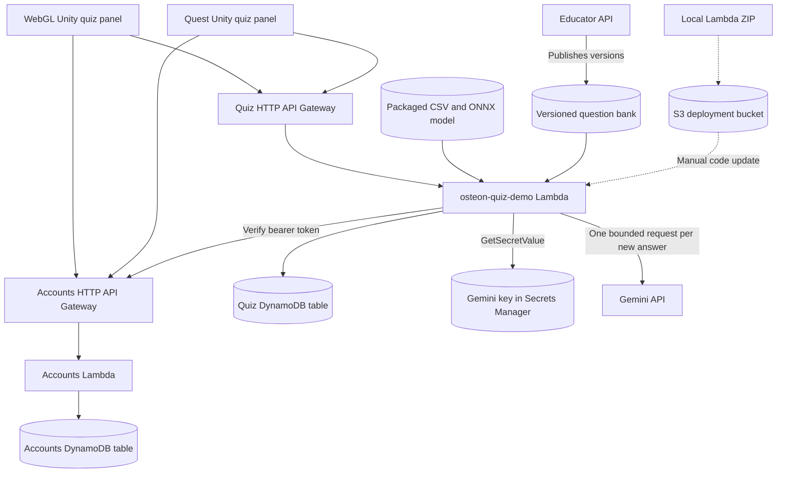

# AWS architecture — account-aware practice quiz

The accounts, quiz, and educator portal use the maintainer's personal AWS
account in `ap-southeast-2`. The
[2026-11-10 deployment record](../Backend/educator-portal/README.md#deployment-record-and-remaining-work)
describes the question-bank integration and cloud checks.

Both clients use the same public account and quiz API origins. Account tokens
remain in client memory. The quiz Lambda verifies each bearer token through
`/v1/auth/me` at the Accounts API and uses the verified learner ID for quiz
state. It reads the pinned question-bank version, runs the ONNX model, scores the answer,
optionally requests a Gemini explanation, and saves progress in its DynamoDB
table. The Gemini key is stored separately in Secrets Manager. Neither client
contains the key or accesses DynamoDB directly.

The S3 deployment bucket supplies Lambda code updates. The anatomy scene and
display preferences operate locally. The training
notebook and `Osteon_Agentic_AI_Pipeline/` prototype are not hosted parts of
this path. For the per-answer decisions, fallbacks, and feature flags, see the
[AI pipeline diagram](QUIZ_AI_PIPELINE.md). For resources, deployment, and
acceptance checks, see [quiz integration](QUIZ_INTEGRATION.md).
