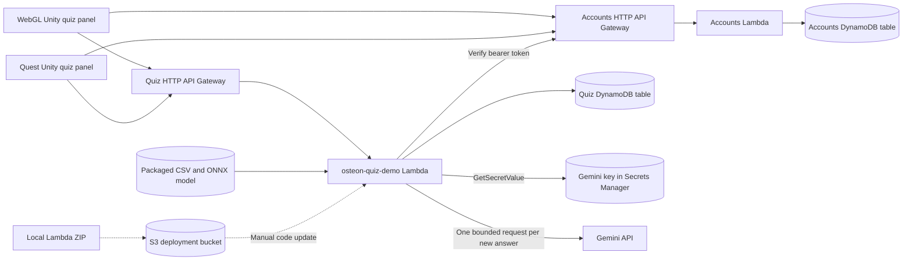

# AWS architecture — account-aware practice quiz

> Current documented deployment, 2026-11-06, in the owner's personal
> `ap-southeast-2` account. The owner reported deploying the feedback fix and
> testing the quiz in WebGL and VR. Console configuration has not been read
> back by this agent since browser access was denied.

Both clients use the same public account and quiz API origins. Account tokens
remain in client memory. The quiz Lambda verifies each bearer token through
`/v1/auth/me` at the Accounts API and uses the verified learner ID for quiz
state. It reads the packaged question CSV and ONNX model, scores the answer,
optionally requests a Gemini explanation, and saves progress in its DynamoDB
table. The Gemini key is stored separately in Secrets Manager. Neither client
contains the key or accesses DynamoDB directly.

S3 is used only to deploy Lambda code; it is not in the live quiz request
path. The anatomy scene and display preferences operate locally. The training
notebook and `Osteon_Agentic_AI_Pipeline/` prototype are not hosted parts of
this path. For the per-answer decisions, fallbacks, and feature flags, see the
[AI pipeline diagram](QUIZ_AI_PIPELINE.md). For the resource history and
verification record, see [quiz integration](QUIZ_INTEGRATION.md).
