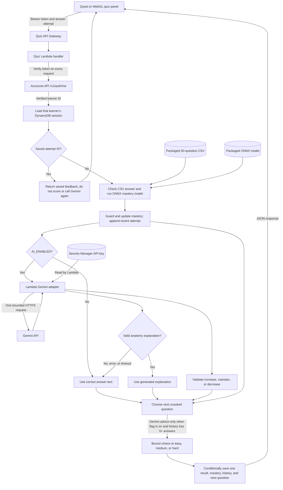

# Account-aware quiz and AI pipeline

This is the current answer path for the shared Quest and WebGL quiz. The
clients receive feedback and the next question; scoring, the model, and the
Gemini key stay on the server.

The scorer uses the question bank's answer key and the ONNX model's mastery
delta. A guard ensures wrong answers do not raise mastery and correct answers
do not lower it. Gemini cannot change correctness, the answer key, or mastery.
Its single structured response contains an anatomy explanation and a suggested
difficulty action. Invalid or unavailable explanation text falls back to the
correct option and answer text. A valid explanation can still be used when
the recommendation is invalid.

The next-question selector already uses mastery: below 0.50 it prefers Easy,
0.50–0.75 Medium, and above 0.75 Hard. `AI_ADAPTATION_ENABLED` adds Gemini's
bounded recommendation after at least five recorded answers; while it is
`false`, selection remains mastery-based. An exhausted preferred tier falls
back to the mastery tier, then the first remaining question. The server records
both the recommendation and the selected tier so they can be compared.

The quiz Lambda verifies the bearer token through the separate Accounts API on
each protected request and uses only the returned learner ID to access the
session. DynamoDB holds each learner's current question, mastery, recent
history, and saved answer result. An answer retry with the same attempt ID
replays that saved result. A conditional write prevents a concurrent answer
from silently overwriting another accepted answer.

S3 stores Lambda deployment ZIPs; it is outside the live answer path. The
separate `Osteon_Agentic_AI_Pipeline/` directory is a local prototype and is
not the deployed quiz service.

**Observed status (2026-11-06):** The owner reports the quiz works in WebGL and
VR and that same-account progress resumes across them. WebGL screenshots show
two anatomy-focused explanations after wrong answers. The owner reports
enabling Gemini-driven adaptation in Lambda on 2026-11-06; its live behavior
has not been verified. The local review of all 50 keyed answers found two
ambiguous stems and corrected them in an undeployed package; live review of
all 50 generated explanations and real recommendations is still open. See
[content audit](QUIZ_CONTENT_AUDIT_2026-11-06.md) and
[quiz integration](QUIZ_INTEGRATION.md).
