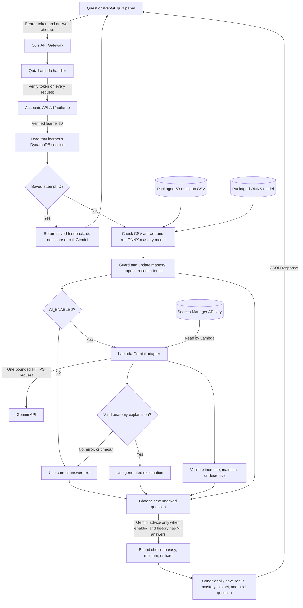

# Account-aware quiz and AI pipeline

Current answer path for the shared Quest and WebGL quiz. Scoring, the model, and
the Gemini key stay on the server.

The scorer uses the CSV answer key and the ONNX mastery delta. A guard ensures
wrong answers do not raise mastery and correct answers do not lower it. Gemini
cannot change correctness, the answer key, or mastery. Its structured response
contains an anatomy explanation and a suggested difficulty action. Invalid or
unavailable text falls back to the correct option and answer text; a valid
explanation is kept even if the recommendation is invalid.

Selection already uses mastery: below 0.50 Easy, 0.50–0.75 Medium, above 0.75
Hard. `AI_ADAPTATION_ENABLED` adds Gemini's bounded recommendation after at least
five recorded answers; while off, selection stays mastery-based. An exhausted
tier falls back to the mastery tier, then the first remaining question. The
server records both recommendation and selected tier for comparison.

DynamoDB stores each learner's current question, mastery, recent history, and
saved answer result. An answer retry with the same attempt ID replays that result;
a conditional write prevents concurrent answers from silently overwriting each
other. S3 stores deployment ZIPs only. The separate
`Osteon_Agentic_AI_Pipeline/` directory is a local prototype, not the deployed
service.

**Status (2026-11-06):** The owner reports a working quiz in WebGL and VR with
cross-device resume, and WebGL screenshots show anatomy-focused explanations.
Gemini-driven adaptation is reported enabled but its live behavior is unverified.
The local review of all 50 keyed answers corrected two ambiguous stems in an
undeployed package; live review of all explanations and recommendations is still
open. See [content audit](QUIZ_CONTENT_AUDIT_2026-11-06.md) and
[quiz integration](QUIZ_INTEGRATION.md).
