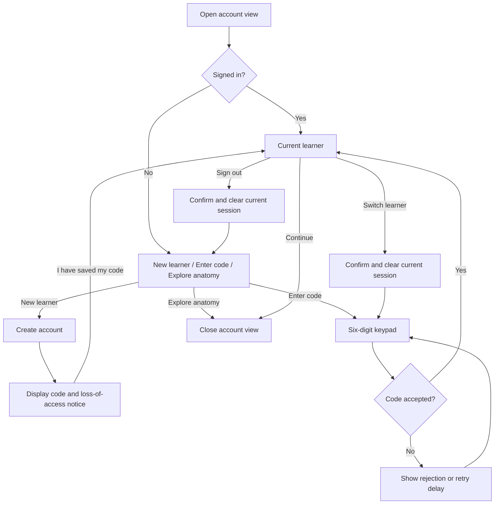

# PLAN-006 — Anonymous user accounts for Quest and WebGL

**Date:** 2026-10-28  
**Status:** Simulator and account UI implemented; automated service checks and C# compilation passed; Play Mode, Quest, and WebGL interaction pending  
**First delivery:** Account screens, session state, a simulated account service,
and a backend handoff contract.

## 1. Goal and confirmed decisions

Create a standalone account flow that gives each learner a stable identity on
Meta Quest and desktop Unity WebGL. Future features can attach their data to
that identity. The AI pipeline will integrate with this account flow later;
its endpoints, scoring, feedback, history, and deployment are outside this plan.

- Accounts are anonymous: no registration form, names, emails, school identity,
  or official grades.
- **New learner** creates an account and receives a server-generated, unique
  six-digit access code. Users do not choose a code or handle uniqueness errors.
- **Enter code** signs into an existing account. Unknown codes never create accounts.
- A code is a six-character string, including possible leading zeros.
- The same code signs into the same account on Quest and web after live integration.
- Login is held in memory until sign-out, app closure, browser reload, or expiry.
  No Remember me, refresh tokens, or persistent login in v1.
- No code replacement or account recovery in v1. Explain this when issuing the code.
- Anatomy exploration remains available without an account or internet connection.
- The first implementation uses a simulated account service. Connecting a live
  account backend is the subsequent milestone.

An account is permanent server-side identity; a login session is temporary device
access. Closing the app ends local access, not the account or its saved data.
Anyone who possesses or guesses the code can access that anonymous account.
This is a limited-protection practice-account design, not verified student identity.

## 2. Account screens and flows

Use an account view within the existing movable station UI, with the same theme,
text-size settings, and controller/mouse interaction as other panels. Keep its
logic independent of quiz state. Anatomy navigation remains unchanged while the
account view is open.

| Screen or event | Required behavior |
|---|---|
| Welcome | New learner, Enter code, Explore anatomy. No automatic account creation on app launch. |
| Creating account | Show progress and disable duplicate submission. Retain one random request ID for retries. |
| Code issued | Display the full code and: "Save this code. Without it, you cannot return to this account after signing out." Require **I've saved my code** before proceeding. Clear the displayed code from memory when dismissed. |
| Code entry | Six numeric slots, masking, press-to-reveal, backspace, clear, Continue, and Cancel. Continue requires exactly six digits. |
| Current learner | Show a non-secret generated label such as Learner followed by a short identifier, plus Continue, Sign out, and Switch learner. Never use the secret code as the label. |
| Cancel / close | Return to the previous account screen or anatomy. Closing the panel does not sign out. Unacknowledged newly issued codes remain available in memory until acknowledged or the app closes. |
| Sign out | Confirm, clear current credentials and account-specific UI, invalidate outstanding callbacks, and show Welcome. |
| Switch learner | Confirm and perform the same cleanup, then open code entry. A failed next login must not restore the previous account. |
| Expired login | Clear the session and show "Your session ended. Enter your code again." Retain no authenticated access while the learner re-enters it. |
| App restart / browser reload | Begin signed out. The learner can enter the same code to access the existing account. |
| Forgotten code | Explain that recovery is unavailable and offer New learner. Do not promise retrieval, merging, or restoration of the old account. |

On shared headsets, keep Switch learner easy to find. The app cannot infer that
the headset has changed hands; the user must switch or sign out.

### Failures and interrupted requests

- **Generated-code collision:** the service chooses another code internally.
- **Unknown, disabled, or revoked code:** use one generic message: "Unable to use
  this code. Check it and try again." Do not reveal which account exists.
- **Too many attempts:** show the server-provided retry countdown and disable
  submission. Enforcement happens on the server, including guesses across codes.
- **No connection / service unavailable:** show Retry and Explore anatomy. Do not
  describe network errors as an incorrect code or create a local fallback account.
- **Creation response lost:** retry the same request ID to receive the same account
  and issued code. Do not generate a fresh request ID just because a request timed out.
- **App closed before receiving or saving the code:** no recovery in v1. A newly
  created account may become inaccessible; the code screen must explain this.
- **Sign-out offline:** immediately clear local access. Remote session invalidation
  cannot be confirmed until the service is reachable or the session expires.
- **Late response after cancel or switching:** discard it. It must not sign someone
  back in, show a secret code unexpectedly, or replace the new learner's identity.
- **Same account on two devices:** allow separate login sessions. Signing out on
  one device does not sign out the other. Sign out everywhere is outside v1.

## 3. Account service and integration contract

### Responsibilities and state

The account service owns account creation, code uniqueness, code validation,
login issuance, expiry, and revocation. Unity owns presentation and the current
in-memory login. No account data is sent directly from Unity to a database.

Minimum logical records:

| Record | Required information |
|---|---|
| Account | Stable random `learner_id`, generated non-secret `profile_label`, protected code lookup, creation time, and active/disabled status. |
| Login session | Account reference, protected session credential, creation time, expiry, and revoked status. Multiple device sessions may reference one account. |
| Creation retry | Random request ID mapped to the issued account and protected creation result for a bounded retry window. |

Reserve a generated code and create its account atomically. Code uniqueness
alone must not be implemented as an unchecked read followed by a write. Use
cryptographically random codes and session credentials. Code lookup protection
must account for the small code space; a bare unkeyed hash is insufficient.
Protect any retained code-bearing creation response and expire it after the
retry window. Never log codes, session tokens, or creation request IDs.

### Proposed public API

These routes are a contract to implement, not existing functionality.

| Route | Request | Successful result |
|---|---|---|
| `POST /v1/auth/profiles` | Random `request_id`, reused for retries of the same creation operation | `learner_id`, `profile_label`, `access_code`, `access_token`, `expires_in` |
| `POST /v1/auth/login` | Six-character `access_code` | `learner_id`, `profile_label`, `access_token`, `expires_in` |
| `GET /v1/auth/me` | `Authorization: Bearer <access_token>` | Verified `learner_id`, `profile_label`, remaining `expires_in` |
| `POST /v1/auth/logout` | Current bearer credential | Idempotent success; invalidates this login session only |

- Responses are JSON over HTTPS with `Cache-Control: no-store`.
- Use 400 for malformed requests, 401 for invalid/expired authentication,
  429 with `retry_after_seconds` for throttling, and 503 for service unavailability.
- Use a proposed 24-hour creation-retry window. A replay returns the same account
  and code; if its original login has expired, the learner signs in with that code.
- For the simulator, use a one-hour login lifetime and configurable clock so expiry
  can be tested immediately. The live service supplies the lifetime through
  `expires_in`; Unity does not hardcode it.
- The client treats tokens as opaque credentials. Token format and hosted-service
  implementation are backend concerns; all protected operations must verify them.
- Require creation and login abuse limits in the live service. UI countdowns alone
  do not provide protection. Live thresholds are a backend release configuration.
- Configure deliberate WebGL origins and preflight support for Authorization,
  Content-Type, and the listed methods before live browser testing.

### Boundary for future features

Expose one account state containing `learner_id`, `profile_label`, the in-memory
credential, and expiry, plus a sign-in/sign-out/session-change notification.
Future client features may use the credential to access protected APIs. Their
backends derive the learner ID from verified authentication and store data under
that identity; they must not trust a caller-supplied learner ID.

This boundary is the only integration requirement here. Account creation and
login must work without calling an AI service or creating a quiz session.

## 4. Implementation milestones

### Milestone 1 — UI and simulated accounts

1. Add one account-state owner and a small account-service interface for create,
   login, current identity, and logout. Use the API results above for both the
   simulator and eventual HTTP adapter.
2. Build the account screens in the existing enabled scene and station UI. Continue
   returns to anatomy with the account active; it does not invoke another service.
3. Add a development-only simulated service with multiple accounts, separate login
   sessions, collision handling, creation retries, expiry, and controllable errors.
   It persists accounts across sign-out within the running process; it resets when
   the process restarts. Clearly label simulated mode to avoid promising real storage.
4. Keep all client credentials in memory. Do not put them in PlayerPrefs, browser
   persistence, Resources, screenshots captured by diagnostics, or logs. Simulated
   credentials must never be sent to live endpoints; block mock mode in release builds.
5. Use a 20-second client timeout. Tag each request with the current account-operation
   generation and discard callbacks after cancellation, sign-out, or switching.
6. Validate the account experience on Quest and in a rebuilt desktop WebGL player.

### Platform details

- Quest uses large controller-ray keypad buttons and the existing Move bar.
- WebGL uses the same view with mouse and numeric keyboard entry. Release mouse
  capture while account entry is focused. Enter submits; Backspace edits a digit.
- Update desktop input focus handling so Backspace does not also navigate anatomy
  Back, and account typing does not move the camera or rotate a bone. Restore prior
  input behavior when the view closes.
- Apply existing themes and text sizes; check the code-loss notice at large text.
- Exclude codes and credentials from narration. Instructions may be narrated where
  platform narration already exists; do not add browser narration in this task.

### Milestone 2 — Live account backend

Deliver the API contract, fixtures, and acceptance cases to the backend implementer.
Once compatible endpoints exist, connect the HTTP adapter and verify account
creation, per-device session revocation, throttling, expiry, and database persistence.
Use separate test accounts; remove simulated access from release builds.

Live acceptance requires signing into one account on Quest and web, proving they
resolve to the same stable identity, then proving a second account remains distinct.
No AI or quiz request is required to pass this milestone.

### Milestone 3 — Later feature integration

Other services can consume the verified identity/session boundary after account
acceptance. Plan their behavior separately; they are not a prerequisite for
building or completing the account flow.

## 5. Acceptance and completion

- New account creation produces exactly six digits, including leading zeros.
- Generated-code collisions are handled internally; repeated creation requests
  return one account, including after a lost response.
- Valid code signs into the existing identity; unknown or malformed codes never
  create accounts. Generic rejection and rate-limit countdowns work.
- Two accounts remain isolated. Two devices can hold separate sessions for one
  account; revoking one session does not revoke the other.
- Closing a panel keeps login; sign-out, expiry, app restart, and browser reload
  clear local access. None deletes the server account.
- No pending callback can restore a signed-out learner or replace the next learner.
- Network loss never creates a local account or prevents anatomy exploration.
- Lost-code messaging accurately states the lack of recovery; secrets are absent
  from logs and narration.
- Quest ray input, desktop keypad/keyboard, cursor focus, Backspace isolation,
  themes, text sizes, and panel dragging work in the actual enabled scene.
- Simulator tests pass without network or AI dependencies. Record Play Mode,
  Quest, and browser results separately; a build alone is not an interaction pass.
- Live service tests later verify persistence, verified identity, revocation,
  expiry, abuse controls, and browser CORS against isolated test accounts.

Milestone 1 is complete when the account UI, simulated service, tests, and handoff
contract are ready. The account feature is live only after Milestone 2 passes.
The first delivery now has an implementation and backend handoff in
[User accounts](../Docs/USER_ACCOUNTS.md). On 2026-10-28, 34 service/state assertions
passed and the runtime C# project compiled with the new sources. Unity batch
validation failed during licensing startup and crashed before the suite ran.
Quest and rebuilt WebGL interaction remain unverified; the live backend is pending.

Reference context: [desktop WebGL controls](../Docs/WEB_DESKTOP.md),
[current architecture](../Docs/ARCHITECTURE.md), and
[account ownership notes](../Docs/ACCOUNTS.md).
