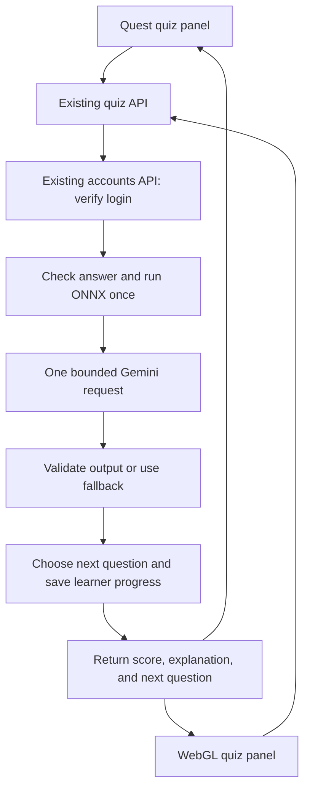

# PLAN-007 — Account-aware AI quiz for Quest and WebGL

**Date:** 2026-11-03

**Status:** Source implemented and account-aware quiz deployed on 2026-11-05.
Two-learner API isolation passed. The owner deployed the 3.5 Flash-Lite quiz
package and WebGL screenshots show both generated and fallback feedback. The
generated text discussed mastery instead of anatomy; the owner deployed a
feedback fix, and two later WebGL screenshots showed anatomy-focused answers.
Updated WebGL and Android builds succeeded. The owner reports the quiz works
in WebGL and VR and confirmed same-account progress resumed across devices.
Full question-bank explanation review, Gemini-driven
adaptation, and detailed platform acceptance remain open. See
`Docs/QUIZ_INTEGRATION.md`, `Docs/QUIZ_AI_PIPELINE.md`, and
`Docs/QUIZ_CONTENT_AUDIT_2026-11-06.md`.

**Targets:** Meta Quest Android and desktop Unity WebGL, using Unity 6000.3.2f1 and the enabled controller-migration scene

## 1. Decision in plain language

Extend the existing quiz backend with the proposal's two useful features:
explanations of answers and recommendations about the next question's difficulty.
Return both from one Gemini request after the backend scores an answer. Quest and
WebGL use the same account, quiz API, and response format.

Accounts are already implemented. The next task is to connect the quiz to those
accounts, then add the AI features. Keep the existing account service and quiz
service; add the AI logic inside the quiz service. No third hosted pipeline is
needed for this delivery.

This plan replaces the earlier sequencing advice to build accounts first. It
plans integration and optimization; it does not claim these features already run.

## 2. Verified starting point and remaining connection

Based on the local source and verification records on 2026-11-03:

- `HttpLearnerAccounts` connects the account UI to the live account API in both
  player targets. Profiles persist, and temporary login tokens stay in memory.
  [User accounts](../Docs/USER_ACCOUNTS.md) records successful live HTTP checks;
  browser account interaction and physical Quest acceptance remain pending.
- `OsteonQuizDemo` still requires the separate shared `demoToken`. Signing into
  Accounts does **not yet** make quiz progress belong to that learner.
- The quiz Lambda accepts an upstream verified JWT identity or its shared demo
  credential. The account service issues opaque random session tokens, so simply
  substituting the account token in Unity is insufficient.
- Quiz storage is already keyed by `learner_id`. Session revisions and answer
  retry handling already protect progress from several concurrent-update cases.
- `Osteon_Agentic_AI_Pipeline/` is a separate local prototype. Its two endpoints
  run ONNX/Gemini assessment and Gemini explanations. It expects its caller to
  supply history and does not own persisted quiz sessions or question selection.
- The optimized WebGL build excludes the private quiz demo configuration. The
  integrated quiz therefore needs public endpoint configuration and the current
  account credential; it must not depend on restoring that private config.

## 3. Optimizations compared with the prototype

| Prototype approach | Planned change | Reason |
|---|---|---|
| Separate FastAPI application | Add a small AI module inside `Backend/quiz-api` | Reuse the deployed quiz routes, session logic, storage, and deployment path. |
| Separate assessment and explanation calls | One structured Gemini response containing both outputs | Avoid sending the same question context twice and reduce ordinary per-answer requests. |
| Assessment reruns ONNX | Reuse the quiz scorer's existing prediction and guarded mastery result | Keep one scoring decision; preserve the existing checks on invalid or contradictory deltas. |
| Caller supplies correct answer, mastery, and history | Build context from the server's question bank and authenticated learner state | Prevent inconsistent scoring and mixing learners' histories. |
| LangGraph/LangChain orchestrate a fixed sequence | A direct Gemini HTTPS request using Python's existing standard-library facilities | This sequence needs no graph runtime; keep the Lambda package small. |
| Recommendation is returned but never applied | Add an explicit, bounded rule for choosing the next tier | Deliver adaptive behavior with a testable meaning for each action. |
| Feedback fallback exists outside the active route | Put validation, timeout, and deterministic fallback in the actual answer path | Provider failures must not prevent normal scoring and question selection. |

Reuse the prototype's helpful prompt rules: supplied correctness is authoritative,
do not invent learner history, and a positive model delta alone does not require
harder questions. Gemini does not change correctness, mastery, or the answer key.

Google supports JSON Schema in its REST interface; validate the returned fields
again in our backend. See [Gemini structured outputs](https://ai.google.dev/gemini-api/docs/structured-output).
Set the model through server configuration and verify that exact model's structured
output support and availability during implementation. The prototype's model name
and comments are not a verified latency or cost benchmark.

## 4. Shared request flow

### Connect account identity first

1. Unity obtains the current session from `LearnerAccountPanel.State`, sends its
   bearer credential, and requires sign-in before starting/resuming practice.
2. The quiz backend verifies that credential through the existing accounts
   `GET /v1/auth/me` endpoint at a fixed server-configured HTTPS origin. Disable
   redirects and never accept the verifier URL or learner ID from the client.
3. Use only the verified `learner_id` for quiz reads and writes. Verify every
   protected quiz request, including saved answer replays. Do not cache successful
   verification across requests in v1, preserving logout/expiry behavior.
4. Invalid/revoked/expired credentials return 401. A verifier timeout or unavailable
   service returns 503 without scoring. Never fall back to the shared demo identity.
5. The account-based quiz deployment disables the demo-token fallback. Existing
   shared-demo progress stays separate; new learners begin with fresh progress.

Using the existing verifier avoids adding JWT issuance, another authorizer, or
sharing account protection keys with the quiz Lambda. Measure this extra network
hop in acceptance; replace it only if measured performance warrants another design.

### Score, enrich, and save

1. Authenticate; validate session, question, choice, and `attempt_id`. Return a
   matching saved retry result before ONNX or Gemini. Reusing an attempt ID with
   a different question/choice is a conflict, not a new submission.
2. Compute correctness and mastery through the existing quiz scorer. Expose its raw
   ONNX delta internally alongside the applied delta/mastery, clearly distinguishing
   the model prediction from scoring guardrails without running inference again.
   Build Gemini context from that result, the question/options, and recent attempts.
3. Make at most one Gemini request per processing invocation, with no automatic
   provider retry inside the answer request. Enforce a short total time budget.
4. Validate explanation and recommendation independently. A usable explanation
   can survive an invalid recommendation; difficulty then uses the normal rule.
5. Choose an unasked question, then conditionally save mastery, bounded history,
   explanation, applied decision, and the complete retry response together.
6. Return only the committed result. A competing write reloads the accepted result
   for the same attempt or returns 409. Never return an uncommitted AI decision.

Preserve the existing `last_attempt_id`/`last_result` guarantee. An older retry that
cannot be replayed returns 409 and refreshes current progress; it never scores
again. Concurrent duplicate requests can still spend two provider calls before
one wins the conditional save. V1 guarantees one committed score, not exactly one
provider charge in every race. Do not add a job queue or distributed lock for this
bounded demo workflow unless real measurements justify it.

## 5. History, timing, and difficulty rules

Persist the last **10 accepted attempts per learner** with question ID, bone group,
actual difficulty, chosen option, correctness, prior/updated mastery, and accepted
time. Keep this small history across quiz restarts while the content version is
unchanged. Clear incompatible history after a question-bank/model version change;
preserve the existing mastery/session migration behavior. Retrying an answer must
not append another attempt.

Send Gemini only the current question and those compact learning records, including
the current result once. Omit account labels, learner IDs, codes, credentials, IPs,
and unrelated profile data. Describe the sample as recent attempts, not a complete
learning record. Empty history means insufficient historical evidence.

**Timing limitation:** the current backend starts the next question's timer before
the learner presses Next. That interval includes feedback reading, idle time, and
network delay. Move the next `issued_at` assignment after AI processing so the new
provider wait is excluded. Preserve the scorer's existing elapsed-time input in
v1, but omit response-time trends from Gemini context and do not describe them as
active thinking time. Accurate active-question timing is a separate change; the
existing metric's limitation must remain documented in evaluation results.

Define recommendation behavior explicitly:

- Easy = 0, Medium = 1, Hard = 2. Actions are relative to the difficulty of the
  question just answered: increase +1, maintain 0, decrease -1, clamped to 0–2.
- Start/resume continues to use the saved current question. Gemini runs only when
  processing a new answer, never just because a learner logs in or resumes.
- Use the existing mastery-based choice while adaptation is disabled, when fewer
  than **5 accepted attempts including the current one** are available, or when
  the recommendation is invalid/unavailable. These are initial engineering
  defaults for evaluation, not validated learning thresholds.
- When enabled and eligible, prefer the first unasked question in the recommended
  tier. If that tier is exhausted, use the existing mastery-based selection and
  its existing exhaustion fallback. Never repeat questions to satisfy Gemini.
- Record recommended versus actually selected difficulty separately. At quiz
  completion there is no next question and no applied difficulty change.

## 6. API additions, deadlines, and fallback

Keep the existing `/v1/sessions`, `/v1/sessions/current`, and
`/v1/sessions/{session_id}/answers` routes. The answer request remains
`question_id`, `choice`, and `attempt_id`; the bearer token supplies identity.
Add these optional fields to the answer response:

| Field | Meaning |
|---|---|
| `explanation` | Short plain text, at most 600 characters; ideally two or three sentences. |
| `explanation_source` | `gemini` or `fallback`. |
| `recommended_action` | One of the three actions, or null when unavailable. |
| `difficulty_source` | `gemini` when its tier was applied, otherwise `mastery`; `none` at completion. |

Retain all existing score and `next_question` fields. Older clients can ignore
the additions; new clients display ordinary answer feedback when they are absent.
New clients require the account-compatible backend before rollout.

The internal Gemini response includes `explanation`, `recommended_action`, and a
brief `assessment` for evaluation. Do not show the assessment as a diagnosis or
store verbose reasoning. Apply strict type, action, and length validation; render
plain text with rich-text interpretation disabled for generated content.

Initial budgets: account verification up to **3 seconds**, Gemini up to **5 seconds**,
and the complete quiz handler targeted below **15 seconds**, within the existing
20-second Unity timeout. Reserve time for storage and serialization. Enforce total
provider elapsed time and response size, not merely a per-read socket timeout.
Bound storage SDK timeouts/retries within the remaining handler budget as well.
Measure cold and warm requests; these are budgets, not promised production latency.

Gemini timeout, quota limit, malformed output, blocked response, or missing AI
configuration uses the existing correct answer plus option text as feedback and
the normal mastery rule. Authentication and database failures remain real errors;
they must not show a successful save. A lost response retries the same attempt ID.

Use server flags `AI_ENABLED` and `AI_ADAPTATION_ENABLED`. Disabling AI preserves
account-based practice. Disabling adaptation keeps explanations and permits
recommendation evaluation without changing question selection.

## 7. Unity behavior on both targets

- Reuse one coroutine-based `UnityWebRequest` path and serializable response
  types in `OsteonQuizDemo`. No Gemini SDK, ONNX runtime, or provider key goes into
  either Unity build. Keep only public service URLs in build configuration.
- Subscribe to account-state changes. Bind every quiz operation to learner ID,
  credential/session, and an operation generation. Cancel/discard stale callbacks
  after sign-out, expiry, switch, or leaving that operation. Clear prior learner
  questions, scores, AI feedback, and narration immediately on account change.
- Preserve pending `attempt_id` across transport retries. On expiry, retain a
  pending answer only in memory, keyed to its original learner/session, and offer
  retry only after that same learner signs back in. Switching to someone else
  discards it. A 409 reloads current progress rather than restarting practice.
- A request already accepted by the server may finish after local cancellation.
  Show uncertain save status when appropriate and fetch current progress on return.
- Start/Resume is account-gated. Stop/Hide keeps login. Exploration remains usable
  during account, quiz, and AI failures.
- The present feedback area is only 80 UI units high. Replace it with a readable
  feedback view using the area freed by answered choices, existing scrolling,
  themes, and text-size preferences. Keep Next and Move reachable at large text.
- Quest: controller-ray selection/scrolling and panel movement; existing narration
  can read the explanation and must stop on account/question change.
- WebGL: mouse/keyboard UI, cursor release and scroll isolation; no blocking wait
  or required browser narration. Browser speech remains outside this delivery.

Unity documents coroutine-based requests and browser CORS requirements in
[Unity 6000.3 Web networking](https://docs.unity3d.com/6000.3/Documentation/Manual/webgl-networking.html).
Allow the intended web origins on the **quiz** API as well as the account API:
`http://localhost:8000` for local testing and the exact HTTPS deployment origin
when selected, GET/POST, and authorization/content-type/x-unity-version headers.
Verify OPTIONS and actual success/error responses. Account API CORS passing does
not establish quiz CORS. Use bearer headers with browser credentials disabled.

## 8. Implementation order and ownership

| Delivery | Concrete finish line | Main files |
|---|---|---|
| 1. Connect accounts to quiz | Learner A and B have isolated progress; one account resumes on web and Quest; revoked/expired tokens fail | `Assets/Scripts/OsteonQuizDemo.cs`, `LearnerAccounts.cs`/panel integration, `Backend/quiz-api/handler.py`, small account verifier, public quiz config |
| 2. Add combined AI and history | One normal processing call returns explanation and recommendation; timeout falls back; retries save once | New `Backend/quiz-api/ai_feedback.py`, `quiz_service.py`, scorer/selection helpers in `quiz_engine.py`, existing tests |
| 3. Enable bounded adaptation | Reviewed recommendations map to the documented tiers, with sparse-history and exhausted-tier fallbacks | Same service/engine, evaluation fixtures, server flag |
| 4. Accept both builds | Fresh optimized WebGL and Quest APK pass the shared and platform-specific cases below | Feedback UI, build configuration, API CORS, verification docs |

After the response contract is agreed, Unity feedback work and the backend AI
module can proceed independently using fixtures. One integration owner controls
the answer transaction, history shape, and difficulty policy. Do not separately
replace the quiz backend while account/client integration targets its old routes.

Deploy the account-compatible quiz backend with AI disabled first, then rebuild
both clients without shared demo secrets. Enable explanations with adaptation off,
review results, then enable adaptation after its acceptance gate. Full delivery
includes both proposed AI functions; the flags support verification and rollback.

Keep the Gemini key in a separate server secret, accessible only to the quiz
Lambda; do not modify the account service's existing protection keys. Cache the
provider credential/configuration per warm worker, not learner responses across
accounts. Google explicitly advises keeping provider keys out of browser/mobile
clients: [Gemini API key handling](https://ai.google.dev/gemini-api/docs/api-key).
Use existing gateway throttles and provider quotas; record request duration,
token usage when provided, fallback category, and decision source without logging
credentials or full learner prompts. Verify the Lambda package remains deployable
and outbound HTTPS works before enabling AI.

## 9. Acceptance and completion

Automated checks using a fake provider and account verifier:

- Two learners' history/progress remain isolated. Revoked, expired, and simulated
  credentials never reach scoring; verifier outages return 503.
- One ordinary answer runs ONNX once and Gemini once; a saved retry runs neither.
  Concurrent/lost-response attempts commit one score and one history entry.
- Invalid recommendations, oversized/invalid explanations, quota failures, and
  timeouts take the specified fallbacks. A valid explanation with invalid advice
  keeps the explanation and uses mastery selection.
- All tier boundaries, fewer than five attempts, exhausted tiers, final question,
  history bounds, content-version changes, and flags behave as documented.
- Pending responses after switch/expiry cannot change the current learner's UI;
  reauthentication retries belong only to the original learner. Old retries/conflicts
  refresh state and never silently restart or double-score.
- Generated markup is displayed as plain text. No secrets or profile identifiers
  appear in provider payloads, player assets, narration, or diagnostic output.

Live/content checks before enabling adaptive selection:

- Review explanations for all 50 current questions with representative wrong and
  correct choices. Record factual errors and answer-key contradictions; unresolved
  errors block acceptance for the affected content. JSON shape alone proves no
  anatomical accuracy.
- Review weak, improving, mixed, and sparse learner fixtures, including repeated
  evaluations for consistency. Document limitations; do not claim educational
  improvement from functional tests alone.
- Record cold/warm answer latency and forced fallback behavior within the budget.
  Check actual provider use/cost; do not claim a percentage saving from call count.

Platform checks (record separately):

- **WebGL:** fresh optimized build; Firefox plus the chosen Chromium browser;
  create/login, quiz, explanation, Next, resume, switch, reload, and expiry;
  success/error CORS; large text and scrolling; missing/slow API recovery.
- **Quest:** fresh ARM64 IL2CPP APK from the same source/API contract; controller
  rays, readable feedback at large text, scrolling, Move, Next, narration stop,
  Wi-Fi loss/retry, sign-out/switch, and login expiry.
- **Cross-device:** answer as A on web, then resume A on Quest; B stays separate.
  Two clients answering the same current question cannot overwrite each other's
  accepted score. Signing out one session leaves the other valid.

Completion requires these checks and updated `Docs/QUIZ_INTEGRATION.md`,
`Docs/USER_ACCOUNTS.md`, `Docs/WEB_DESKTOP.md`, and `Docs/KNOWN_ISSUES.md` with actual
outcomes. An Editor run, successful APK/WebGL build, or localhost preflight alone
does not establish both-platform acceptance.
