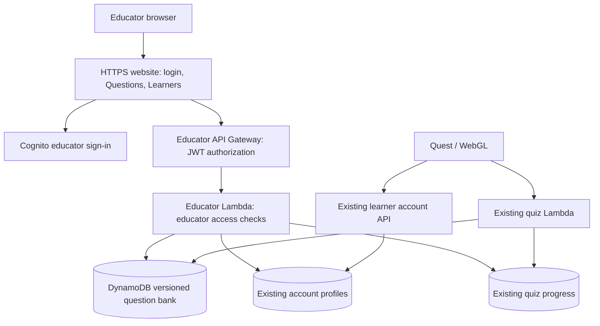

# PLAN-008 — Educator portal and named learner profiles

**Date:** 2026-11-09  
**Status:** AWS backend and portal deployed 2026-11-10; MMSU-domain self-sign-up deployed and infrastructure checked. Complete browser sign-up, first educator sign-in, publication, and live Quest/WebGL acceptance remain open.  
**Targets:** Public HTTPS educator website; existing Python account and quiz
services; Unity 6000.3.2f1 Quest and desktop WebGL clients.

## 1. Agreed scope

Local source and deployment notes are in
[`Backend/educator-portal/README.md`](../Backend/educator-portal/README.md).
The program list and year ranges require the review recorded in
[`Docs/MMSU_PROGRAM_CATALOG.md`](../Docs/MMSU_PROGRAM_CATALOG.md).

Build the smallest usable educator portal: login, Questions, and Learners.
There is one shared question bank and one shared learner list. Every signed-in
educator can view every learner and edit/publish questions. Educators do not
need AWS credentials to use the website.

- Educators self-register through the portal's Cognito sign-up page using an
  `@mmsu.edu.ph` address, confirm their email, and enroll authenticator-app MFA.
  No maintainer approval or group assignment is required. Students with an MMSU
  address can also sign up; this is an acknowledged temporary access policy.
- Questions: review and edit the existing question text, four choices, correct
  answer, bone group/name, difficulty level, and difficulty score; publish changes.
  The current editor keeps the 50 question IDs fixed: educators cannot add or
  remove questions in this release.
- Learners: search by name and inspect program, year level, saved mastery,
  current quiz progress, and the retained recent answers (at most 10).
- Learner profiles gain first name, last name, optional middle name, MMSU
  program, and year level. Existing accounts complete these after login.
- Published question changes apply to newly started quizzes. Active quizzes
  continue using their original bank version.
- Edited question content must never play an outdated bundled recording.

Classes, enrollment codes, educator invitations inside the portal, approval
workflows, charts, full answer-history collection, CSV import/export UI, new
question creation/deletion, and audio uploads are outside this first release.
The CSV is imported during migration; educators edit through forms afterward.

## 2. Existing system and replacement boundary

`Backend/quiz-api/assets/questions_datasets.csv` contains 50 questions. The
quiz Lambda currently loads this packaged CSV and the packaged ONNX model.
S3 holds deployment ZIPs. A CSV change currently changes `content_version`,
causing a fresh run on next start while retaining mastery.

`osteon-accounts` stores anonymous profiles and authentication records.
`osteon-quiz-demo` stores one current quiz state per learner, including mastery
and at most 10 recent answers. Both refer to the same stable learner ID.
Names are not identity keys and must not replace that ID.

`Backend/educator-dashboard/` is a local read-only prototype from this chat.
It does not satisfy this plan and must not be exposed publicly. Replace its
user-facing role with the portal and update its README/root README accordingly.
The existing release handoff remains a record of the previously delivered scope.

## 3. Architecture

Use a small static web frontend hosted through CloudFront and a private S3
bucket, with a separate educator API Gateway/Lambda integration. The quiz's
ONNX and Gemini behavior stay in the existing quiz service.

Use a separate Cognito educator user pool, self-registration restricted to the
exact `@mmsu.edu.ph` domain by a pre-sign-up Lambda, MFA, and
authorization-code sign-in with PKCE. Protect every educator data route with
JWT authorization and a dedicated client/token-type check in Lambda. Learner
tokens must never authorize these routes. Scope CORS to the portal origin.

No AWS credentials, provider secrets, learner access codes, authentication
tokens, or encrypted account replay records may reach the educator frontend.
Responses explicitly select permitted profile/progress fields. Configure
short educator token lifetimes and document expiry/revocation behavior.

## 4. Questions and publishing

### Storage

Add a question-bank DynamoDB table with immutable published versions and an
active-version pointer. Store individual question rows under each version;
retain stable question IDs. Store publication time and educator identity.
Old published versions remain available for active quizzes and retained history.

Separate bank version from model version. A session records the bank version
it started with. Selection, display, grading, and generated-feedback context
must all load that same version. Cache only immutable versions; obtain the
active version when starting a new run.

### Editing flow

1. Load the published bank and its version into the Questions page.
2. Select a question and edit its fields. Changes remain an unpublished draft
   in page memory; show unsaved changes and warn before leaving.
3. Click Publish. Send the complete edited bank and the version it was based on.
4. Validate all fields on the server: required text, bounded lengths appropriate
   to the Unity panel, exactly four nonempty choices, a valid correct letter,
   supported group/difficulty values, and unique unchanged question IDs.
   Determine difficulty-score bounds from the existing model/data contract
   before authoring validation; reject non-finite values.
5. Write a complete new immutable version, then conditionally switch the active
   pointer only if the base version is still current. Incomplete versions must
   never become active. A failed publication leaves the prior bank active.
6. Return the published version and refresh the page. If another educator
   published first, show a conflict and let the user reload/reapply their edits.

Publishing updates database content. It does not build Unity or deploy Lambda.
A maintainer can restore an earlier published version; a rollback UI is deferred.
Include request identity/idempotency so a network retry cannot publish twice or
give a misleading success result.

### Narration

The current `NarrationClips` catalog matches exact text. Preserve that behavior
and verify question text and choice order are represented in the matching text.
Never select a clip solely by question ID. If an edited question lacks a matching
recording, disable its prerecorded question narration with a clear unavailable
state; unchanged question recordings remain usable. Do not disable unrelated
anatomy, settings, or feedback narration. Test both Quest and WebGL behavior.

## 5. Named learner profiles

Add fields to the existing PROFILE record:

| Field | Rule |
|---|---|
| `first_name` | Required, trimmed, Unicode supported |
| `last_name` | Required, trimmed, Unicode supported |
| `middle_name` | Optional, Unicode supported |
| `program_id` | Required stable ID from the maintained MMSU catalog |
| `year_level` | Required positive integer selected from configured year options |

Use bounded text lengths without restricting names to ASCII letters. Keep
program IDs separate from their display names. Maintain one authoritative
program catalog served by the account API so Quest, WebGL, and the portal use
the same values. Use the existing creation request's retry protections when
adding profile fields; retries must not create duplicate accounts.

In the current Unity source, a learner selects **New learner** in the Quest or
desktop WebGL account panel, enters first name, optional middle name, last name,
MMSU program, and year level, then selects **Create account**. The app shows a
six-digit access code to save. That code is needed to return to the same account
after signing out. This is a learner self-service flow; a maintainer does not
create learner accounts. Program choices come from the account API catalog.

New accounts collect these fields during signup. Existing users retain their
ID, access code, and quiz progress; after authentication, show a profile-completion
form if required fields are missing. Permit later corrections through the
learner's own authenticated profile endpoint. Derive the learner ID from the
session, never from a writable request field. Educators only view these fields
in this release. Missing legacy fields display as incomplete rather than causing
the educator list to fail.

The account API and profile forms are implemented in source, and the account
API changes are deployed. The updated Unity clients have not yet been rebuilt
and accepted on Quest or desktop WebGL. Do not claim that the named-profile
flow works in a released headset or browser build until those checks pass.

Program catalog work must cover MMSU's official offerings, not only computing
or health sciences. Current official sources checked on 2026-11-09 include:

- [MMSU college directory](https://www.mmsu.edu.ph/?redirect=0).
- [Health Sciences programs](https://chs.mmsu.edu.ph/article/accreditation-level):
  BS Nursing, BS Pharmacy, BS Physical Therapy, BS Radiologic Technology.
- [Computing and Information Sciences](https://www.mmsu.edu.ph/page/245/1/college-of-computing-and-information-sciences):
  BS Computer Science and BS Information Technology.

The complete catalog and program-specific year ranges still require checking
against official program pages during implementation. Do not assume every
program lasts four years. These profile details are learner-supplied and do
not imply verification against university enrollment records.

## 6. Learner review

The list shows name, program, year level, mastery estimate, and current-run
answer count. Search names and paginate results. Selecting a learner opens
their profile, completion state/current question, and up to 10 retained answers.

The backend joins account and quiz records by learner ID. Return only the
fields needed by the interface. A learner with no quiz state displays “No quiz
started.” Label mastery as a model estimate, not a grade. Do not present the
last 10 answers as lifetime history or infer a full-run score from them.

When showing historical question/answer text, resolve it against its original
bank version. Add bank-version metadata to new retained history entries.
Legacy entries whose source version cannot be established retain their stored
ID, choice, and correctness; do not attach potentially different current text.

For the initial small cohort, a paginated profile scan with an explicit projection
is acceptable. Never scan and return account credential records. Detail views
use keyed reads; handle account-only and missing/legacy quiz records gracefully.

## 7. Implementation sequence

| Step | Deliverable and affected areas |
|---|---|
| 1. Infrastructure and auth | Version-controlled AWS deployment configuration, private static hosting, Cognito, educator API/Lambda, question-bank table, scoped permissions and public endpoint configuration |
| 2. Bank migration and quiz adapter | Import tool; `quiz_engine.py`, `quiz_service.py`, persistence and tests updated for immutable banks and pinned sessions |
| 3. Named profiles | Account Lambda/tests, program catalog, `LearnerAccounts.cs`, HTTP client and `LearnerAccountPanel.cs`; profile completion/correction on both clients |
| 4. Educator API and pages | Login/logout, Questions editor/publication, Learners list/detail, validation and error states |
| 5. Narration and client verification | Verify exact-content matching and unavailable state, rebuild Quest/WebGL, test edited and unchanged questions |
| 6. Release | Staging checks, migration backup, production deployment, smoke checks, updated documentation and acceptance record |

Before migration, read back the actual deployed bank. The repository has
documented local wording corrections that may differ from the deployed CSV.
Preserve the exact live bank as the legacy version and map existing session
content hashes to it. Import reviewed corrections as a separate version.
Do not silently reset active runs or grade old questions using revised keys.

Deployment needs an initial quiz backend update and client builds for profile
forms/narration behavior. Subsequent question publications need neither.
Keep the legacy bank and a deployable rollback artifact; roll out the backend
before requiring new client fields so older installations fail gracefully.

## 8. Acceptance checks

- [ ] Unauthenticated callers and learner tokens cannot read educator data or publish.
- [ ] A self-registered educator can confirm email, complete MFA, and use both pages.
- [ ] All 50 migrated questions preserve their IDs, choices, answer keys, and scoring inputs.
- [ ] Educator publication changes questions used by a new quiz without redeploying code.
- [ ] An existing quiz continues and grades against its original bank after publication.
- [ ] Invalid edits, conflicting publications, retries, and interrupted writes never expose a partial bank.
- [ ] Learner-facing question responses continue to hide the correct answer before submission.
- [ ] New signup and existing-account completion save names/program/year without changing learner identity or progress.
- [ ] Another learner cannot read or edit someone else's profile through a supplied ID.
- [ ] Names with accents/apostrophes and HTML-like input display safely; program/year values are validated server-side.
- [ ] Educator list/detail handles pagination, incomplete profiles, no quiz, and retained history with clear limits.
- [ ] Neither educator responses nor logs expose access codes, session tokens, or provider credentials.
- [ ] Edited-question narration never reads old wording/choices; unchanged narration still works on Quest and WebGL.
- [ ] Current bank selection, scoring, retry, resume, AI fallback, and account-isolation tests pass.
- [ ] Live educator browser flow and named-profile/quiz flows on Quest and WebGL are recorded separately from unit tests.

## 9. Supporting references

- [Cognito managed authentication](https://docs.aws.amazon.com/cognito/latest/developerguide/cognito-how-to-authenticate.html)
- [API Gateway JWT authorization](https://docs.aws.amazon.com/apigateway/latest/developerguide/http-api-jwt-authorizer.html)
- [DynamoDB version checks](https://docs.aws.amazon.com/amazondynamodb/latest/developerguide/BestPractices_OptimisticLocking.html)
- [Existing account service](../Backend/accounts-api/README.md)
- [Existing quiz service](../Backend/quiz-api/README.md)
- [Quiz integration and deployment record](../Docs/QUIZ_INTEGRATION.md)
- [Question content audit](../Docs/QUIZ_CONTENT_AUDIT_2026-11-06.md)
